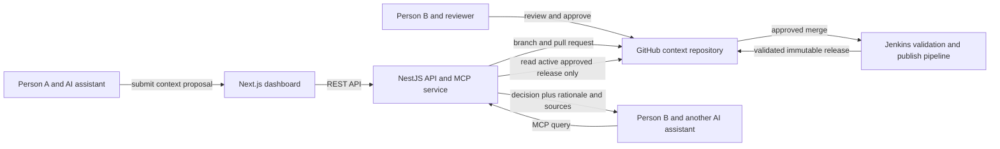

# ContextOps — Architecture (Phase 1)

## Product boundary

ContextOps is a shared, reviewable context layer for a team using different AI assistants. It preserves a useful decision trail from an iterative discussion so another teammate and their AI can retrieve both the outcome and the reasons behind it.

The first use case is Person A discussing PostgreSQL versus MySQL with ChatGPT, then submitting the final decision, rationale, constraints, alternatives, and selected discussion notes for review. After approval, Person B can ask Claude Code and receive that approved context while coding.

## Architecture decisions

| Area | Decision |
|---|---|
| Frontend | Next.js dashboard using shadcn/ui components. |
| Backend | NestJS service for the product API, GitHub integration, validation, release operations, and MCP server. |
| Source of truth | GitHub context repository with Markdown records and YAML front matter. |
| Approval | GitHub pull requests and human review control acceptance. The application and MCP proposal tool cannot approve or merge. |
| Published context | Immutable Git tag or commit-pinned snapshot, selected by one active release reference per project. |
| Search | Begin with keyword and metadata search over the active GitHub-backed context. Add a database/search index only if needed as a rebuildable cache. |
| Development and local run | Ubuntu through WSL on Windows; Docker Compose for the dashboard and backend. |
| Deployment demo | Add Kubernetes only after the core context workflow works. |

## Main components



## Context record

The record must explain the team's reasoning, not only store a final label such as “PostgreSQL.” The first version should support these common fields:

- `id`, `title`, `type`, `project_id`, `created_at`, `updated_at`, and tags
- question or problem being discussed
- final decision or current conclusion
- rationale and relevant constraints
- alternatives considered and tradeoffs
- selected discussion notes, excerpts, or a source reference
- status and reviewer/publisher metadata where applicable

The record types are Decision, Requirement, Constraint, Research, Rejected Approach, Open Question, and Project State. A teammate or AI client submits a curated context record. The first version does not automatically ingest every private conversation.

## Core information flow

1. A teammate discusses a project question with an AI assistant.
2. The teammate or assistant submits a context record with the useful reasoning trail.
3. ContextOps opens a branch and pull request in the project's GitHub context repository.
4. Validation checks the record structure and required metadata.
5. A human reviewer approves and merges the pull request in GitHub.
6. Jenkins publishes a validated, immutable context release. A failed publish leaves the previous release active.
7. Another teammate's AI asks the NestJS MCP service for relevant context.
8. The MCP service reads only the active approved release and returns the decision with its rationale and source references.

## Repository layout

```text
contextrepo/
├── apps/
│   ├── web/                 # Next.js user interface
│   └── api/                 # NestJS REST API and MCP service
├── docs/
│   ├── architecture.md
│   └── implementation-plan.md
└── context-repository/      # Demo context source, separate logically from app source
    ├── context/
    └── schemas/
```

The production context repository is a separate GitHub repository linked by a ContextOps project. The local `context-repository/` folder is only the development/demo fixture unless and until a project is explicitly linked to a remote context repository.

## Trust and access boundaries

- MCP retrieval returns published context only; drafts stay in pull requests.
- MCP proposals create a reviewable pull request and cannot approve or merge it.
- Only validated merged content can be published.
- Publishing a new release does not replace the active release until publishing succeeds.
- Rollback changes the active release reference and keeps the original Git history.
- Secrets are supplied through local environment configuration or a secret manager, never committed.

## What is intentionally not designed yet

Detailed API schemas, MCP tool signatures, GitHub authentication method, frontend screens, and exact CI pipeline stages will be designed in later phases, against this architecture and the first end-to-end use case.
