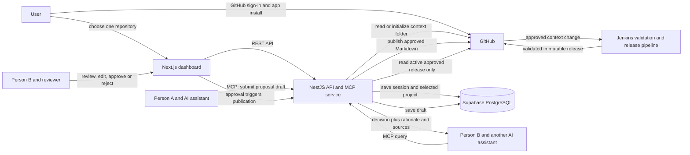

# ContextOps — Architecture (Phase 1)

## Product boundary

ContextOps is a shared, reviewable context layer for a team using different AI assistants. It preserves a useful decision trail from an iterative discussion so another teammate and their AI can retrieve both the outcome and the reasons behind it.

The first use case is Person A discussing PostgreSQL versus MySQL with ChatGPT, then submitting the final decision, rationale, constraints, alternatives, and selected discussion notes for review. After approval, Person B can ask Claude Code and receive that approved context while coding.

## Architecture decisions

| Area | Decision |
|---|---|
| Frontend | Next.js dashboard using shadcn/ui components. |
| Backend | NestJS service for the product API, GitHub integration, validation, release operations, and MCP server. |
| Approved context source of truth | A `context/` folder in the project's existing GitHub code repository, using Markdown records and YAML front matter. A separate context repository is optional, not required for the MVP. |
| Application storage | Supabase PostgreSQL stores GitHub sign-in sessions, the selected repository, proposal drafts/review status, and hashed MCP access keys. It does not replace GitHub as the source of truth for approved context. |
| Approval | People review and approve proposals in ContextOps. MCP can submit drafts only; it cannot approve or publish. After approval, ContextOps writes the validated Markdown record to the connected repository's default branch using a GitHub Contents API commit. |
| Published context | Immutable Git tag or commit-pinned snapshot, selected by one active release reference per project. |
| Search | Begin with keyword and metadata search over approved GitHub-backed context. PostgreSQL also stores app configuration and drafts; drafts are excluded from approved-context retrieval. |
| Development and local run | Ubuntu through WSL on Windows; Docker Compose for the dashboard and backend. |
| Deployment demo | Add Kubernetes only after the core context workflow works. |

## Main components



## Context record

The record must explain the team's reasoning, not only store a final label such as “PostgreSQL.” The first version should support these common fields:

- `id`, `title`, `type`, `project_id`, `created_at`, `updated_at`, and tags
- question or problem being discussed
- final decision or current conclusion
- rationale and relevant constraints
- alternatives considered and tradeoffs
- selected discussion notes, excerpts, or a source reference
- status and reviewer/publisher metadata where applicable

The record types are Decision, Requirement, Constraint, Research, Rejected Approach, Open Question, and Project State. A teammate or AI client submits a curated context record. The first version does not automatically ingest every private conversation.

## Core information flow

1. A teammate discusses a project question with an AI assistant.
2. The teammate writes a proposal in ContextOps, or asks an MCP-connected assistant to submit it. Either way, it is saved only as a draft in PostgreSQL.
3. A person reviews or edits the draft, then approves or rejects it in ContextOps. MCP cannot make this decision.
4. On approval, ContextOps checks required fields and warns about likely conflicts, then commits a Markdown/YAML record under `context/<type>/` in the connected repository. The app stores the resulting path and Git commit SHA.
5. Jenkins validates and publishes an immutable context release. A failed publish leaves the previous release active.
6. Another teammate's AI asks the NestJS MCP service for relevant context.
7. The MCP service reads only the active approved release and returns the decision with its rationale and source references. Drafts are never included.

## Repository layout

```text
contextrepo/
├── apps/
│   ├── web/                 # Next.js user interface
│   └── api/                 # NestJS REST API and MCP service
├── docs/
│   ├── architecture.md
│   └── implementation-plan.md
└── examples/
    └── demo-context/        # Local Markdown fixtures for the first read-only slice
        ├── decisions/
        ├── requirements/
        ├── constraints/
        ├── research/
        ├── rejected-approaches/
        ├── open-questions/
        └── project-state/
```

The Phase 2A read-only slice loaded Markdown fixtures from `examples/demo-context/` through a repository adapter. Phase 2B.2 replaces that adapter with a GitHub-backed reader: the connected project's default branch is scanned under `context/`, and approved Markdown records are validated and displayed. A separate context repository remains optional. PostgreSQL stores project connection settings, proposals and hashed MCP keys; approved context stays in GitHub. Organization membership, teams, and multi-project access are deferred to the final phase.

The Phase 2B onboarding and live context reading slices are implemented: a user signs in with GitHub, installs the ContextOps GitHub App with repository access they select, connects one repository, and can ask ContextOps to add `context/README.md` on that repository's default branch. Supabase PostgreSQL stores the account, hashed ContextOps sessions, GitHub installation, one connected project per user, and drafts. Logout removes only the current session; the project and GitHub installation remain saved. The library reads approved records from GitHub, skips README and drafts, and warns about invalid Markdown files. Phase 3 adds the ContextOps approval queue, commit-on-approval, conflict warnings, and the `submit_context_proposal` MCP tool. Apply migrations `003_context_proposal_drafts.sql` and `004_proposal_review_mcp.sql` before exercising these flows. See `docs/proposal-drafts.md` and `docs/mcp-proposals.md`.

## Trust and access boundaries

- MCP retrieval (Phase 4) returns published context only; the Phase 3 proposal tool submits drafts to PostgreSQL.
- MCP clients can submit drafts but cannot approve proposals or publish records.
- A person approves or rejects each proposal in ContextOps before publication to GitHub.
- Only approved and validated content can be published.
- Publishing a new release does not replace the active release until publishing succeeds.
- Rollback changes the active release reference and keeps the original Git history.
- Secrets are supplied through local environment configuration or a secret manager, never committed.

## Still to design

Immutable context releases, MCP retrieval, exact CI pipeline stages, and production hosting remain for later phases. The ContextOps review screen, draft submission MCP tool, and direct GitHub commit-on-approval are implemented for the MVP. Organization teammates and review roles are deferred to Phase 8; for now, the signed-in project owner is the reviewer. See `docs/github-account-and-repository-connection.md` and `docs/ui-guidelines.md`.
